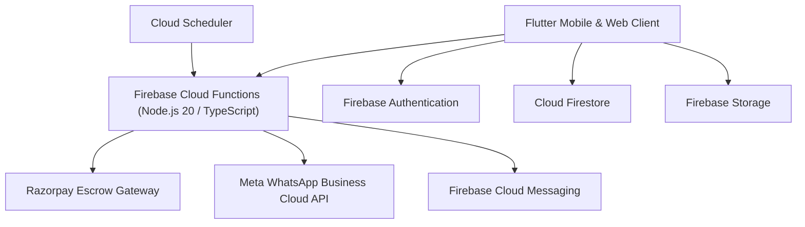

# RoomWala Production Architecture Documentation

## 1. High-Level System Overview
RoomWala is a zero-brokerage room rental marketplace connecting verified room owners directly with verified guests.

## 2. Core Service Boundaries
1. **Auth & Identity Verification**: Secure metadata verification with protected raw ID storage in Firebase Storage.
2. **Atomic Booking Pipeline**: Firestore transactions guarantee zero double-bookings with slot locking.
3. **Escrow Payments**: Razorpay signature verification and automated payout scheduling.
4. **Stay Extension Priority**: 24-hour departure trigger reserving extension window exclusively for active guests.

